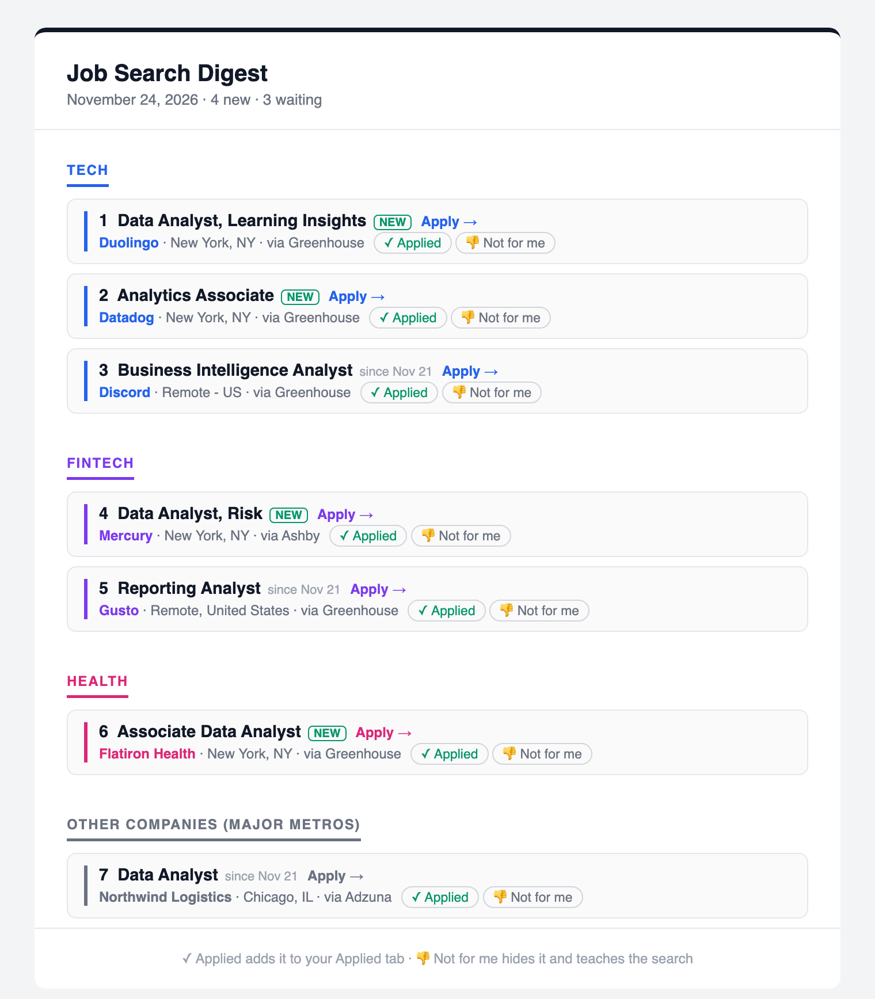
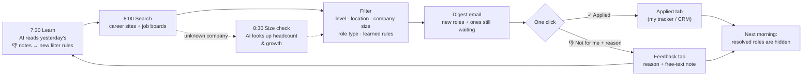

# Job Search Agent

A personal job-search agent I built and run every morning. It checks a few hundred company career sites and job boards and filters out roles that don't fit (wrong level, location, company size or role type). It then emails me a short digest. Each role in the email has two buttons, **✓ Applied** and **👎 Not for me** (with a reason). One click updates my application tracker, a Google Sheet that works as a lightweight CRM. Those reasons also tune the next day's search.



*Sample digest with made-up roles. This repo ships with an example search profile, not my own.*

## Why I built it

Job boards are noisy. The same listings repeat across sites, senior roles slip through junior filters, and good roles at the companies I care about get buried. Keeping a tracker up to date by hand is easy to fall behind on. I wanted one email a day that:

- shows only roles worth my time, from the companies I'm targeting plus solid ones I'd never have found,
- never shows me the same role twice once I've dealt with it, but doesn't let a role I haven't looked at yet disappear,
- logs every application without me copying anything into a spreadsheet,
- gets smarter about what I *don't* want, from my own words.

## The daily cycle



1. **Search (8:00).** `job_search.py` reads jobs straight from each company's career site where possible, and from job aggregators for everything else.
2. **Filter.** Every role is checked against my search profile. The checks cover title keywords, seniority (from the title and from the years of experience the posting asks for), location, and company size. They also drop internships that require current student enrollment, postings that require another language, and sales-development roles hidden behind broader titles.
3. **Digest.** The email shows today's new roles (green **NEW** tag) and any earlier role I haven't acted on yet (grey **since Nov 21** tag). A waiting role keeps appearing for two weeks or until the posting comes down. Before each send, every waiting role is re-checked to make sure the listing is still live.
4. **One-click feedback.** The buttons hit a small Google Apps Script web app attached to my tracker Sheet:
   - **✓ Applied** adds a row to the **Applied** tab: title (linked to the posting), company, location, date and status. It keeps the Sheet's own formatting and status dropdown, so it looks exactly like a row I typed myself. That tab is my application tracker, where I also log interview progress and outreach.
   - **👎 Not for me** asks *why*: one tap on a reason (too senior, wrong role type, wrong industry, location, company too small, not this company), plus an optional free-text note. Everything lands in a **Digest Feedback** tab. Every action has an undo link.
5. **Learn (7:30 next day).** An AI step reads only the new notes and turns clear, lasting preferences into filter rules. Examples are "skip titles with X", "never this company" and "skip postings that require Y". It's deliberately conservative: one-off notes like "listing closed" are ignored, there's a cap on rules per day, and broad words are never banned. New rules are listed in the footer of that morning's email, so I can always see what changed.
6. **Next search.** Before the search runs, the script pulls the whole Sheet. Anything I've applied to (including roles I logged by hand) or passed on is hidden. "Not this company" and "company too small" hide the whole company.

## What's inside

| Part | What it does |
|---|---|
| `job_search.py` | The search, filters, scoring, digest email and send. Python with `requests` and BeautifulSoup. |
| `apps_script/Code.gs` | Google Apps Script web app that sends the digest, records ✓/👎 clicks, writes to the tracker, and serves feedback back to the script. |
| `agents/` | Instructions for the scheduled AI steps (Claude Code scheduled tasks): feedback learning, company-size checks, a weekly funding watch-list, and the daily trigger. |
| `search_profile.example.json` | Every personal setting: target companies and industries, title keywords, seniority and size thresholds, home area. Copy it to `search_profile.json` and make it yours. |
| `run_digest.sh` | Starts a run in the background, so the scheduler never times out, and refuses to start a second copy. |

### Where jobs come from

- **Job-board APIs:** Greenhouse, Lever, Ashby, Workable, Rippling.
- **Enterprise career sites:** Workday, Oracle Recruiting Cloud, SAP SuccessFactors, TalentBrew, Jibe and gr8people. These are set per company, because big employers' sites can't be found from the company name alone.
- **Aggregators:** Adzuna, Remotive, Jobicy, Arbeitnow. These catch companies I hadn't thought of. A company found this way must be in a major metro and pass a size check (roughly 200+ employees, or smaller and clearly growing). Staffing agencies only count in the largest cities.
- **Watch-lists:** companies from hiring lists I come across, plus a weekly AI scan of a VC funding newsletter for newly funded companies. These get searched every day.

### AI steps

The Python script does the deterministic work. A language model is used only where judgment helps, each step has a narrow job and a token budget, and each writes to a single data file the script reads:

- **Feedback learning:** turns free-text 👎 notes into filter rules (`learned_rules.json`).
- **Company size check:** looks up headcount and growth for companies the aggregators found (Indeed data first, then web-search snippets) and flags staffing agencies (`company_profiles.json`).
- **Funding watch-list:** reads a weekly VC funding newsletter and adds plausible hiring targets (`watched_companies.json`).

### Reliability details

- If a run crashes, a "run failed" email goes out with the error instead of nothing arriving.
- The email stays under Gmail's ~102 KB clipping limit: styles live in one CSS block, and the digest is capped at 50 roles.
- Closed listings are dropped before sending: an HTTP 404/410 counts as closed, and Workday postings are checked through their API.
- A role is matched to a tracker entry by company plus fuzzy title matching. So "Coordinator (6-month)" in the Sheet still matches "Coordinator" in a posting.

## Run it yourself

1. Python 3.9+: `python3 -m venv .venv && .venv/bin/pip install -r requirements.txt`
2. `cp search_profile.example.json search_profile.json`, then edit it.
3. Create a Google Sheet with an **Applied** tab (columns: blank, Title, Company, Applied?, Date Applied, Status, …, Location). Open *Extensions → Apps Script*, paste `apps_script/Code.gs`, and fill in `TOKEN`, `SHEET_ID` and `TO`. Then deploy it as a web app (execute as you, access: anyone with the link).
4. Create `.env`:
   ```
   DIGEST_WEBAPP_URL=<your web app URL>
   DIGEST_TOKEN=<same TOKEN as in Code.gs>
   ADZUNA_APP_ID=<optional, free at developer.adzuna.com>
   ADZUNA_APP_KEY=<optional>
   ```
5. `./run_digest.sh` (or `python3 job_search.py` to watch it run), and schedule it daily with any scheduler. I use Claude Code scheduled tasks, with the prompts in `agents/`.

## Privacy

My real search profile, watch-lists, tracker, feedback and learned rules are kept private. This public copy is generated from my private repo by an export script. The script removes personal settings, credentials, IDs and comments, and refuses to finish if any company name, keyword or ID from my real setup appears in the output.
